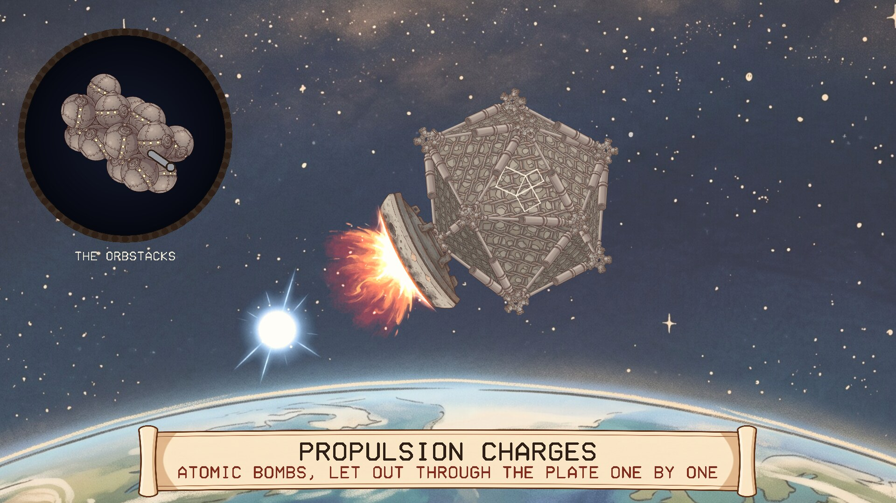
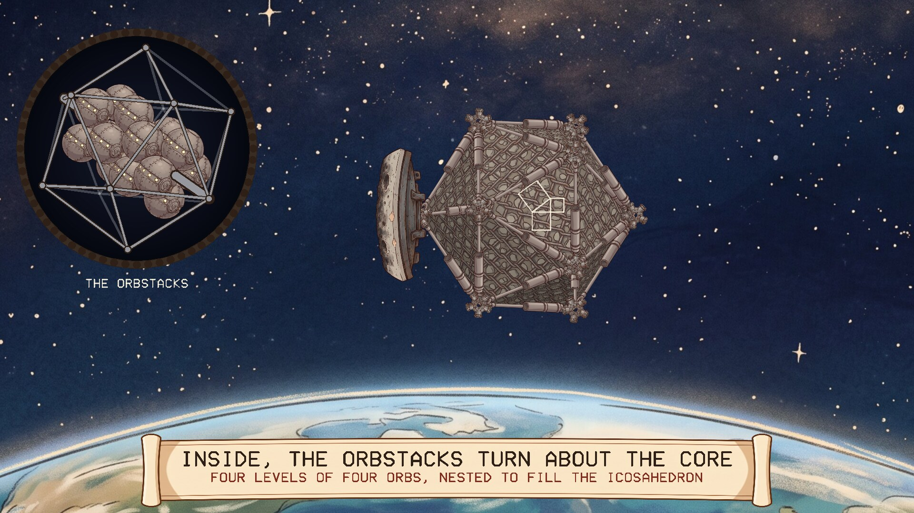
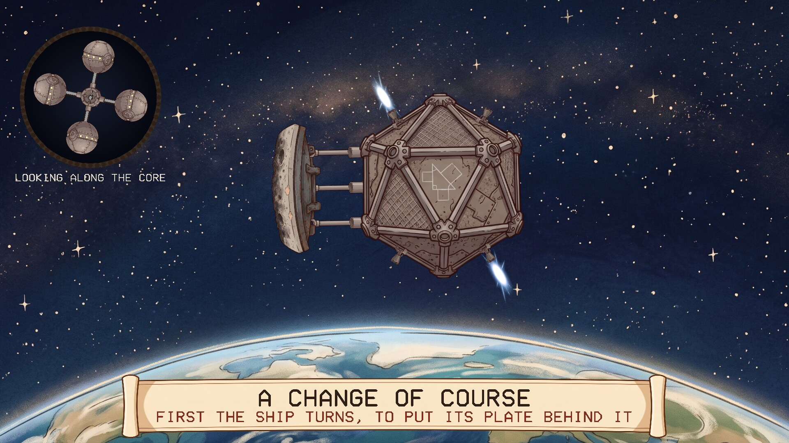
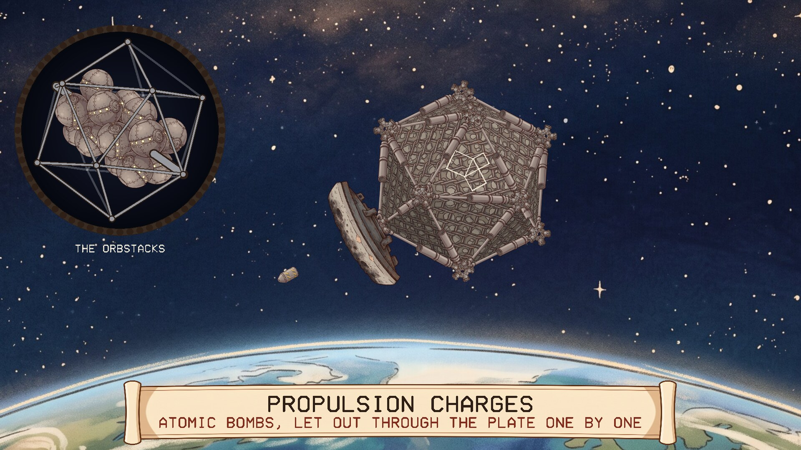
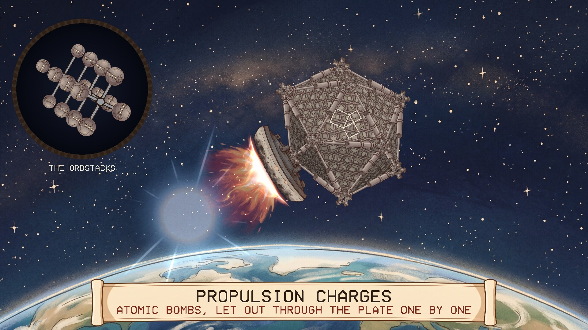

# The Daban Urnud

A screensaver of the Geometers' ship, from Neal Stephenson's novel *Anathem*. Runs
on Linux and Windows.

## The ship

The Daban Urnud is the starship that turns up in orbit about Arbre: an icosahedron
with sixteen orbs inside it, four for each of the four races aboard (Urnud, Tro,
Laterre and Fthos), going round a central Core so that the people living in them
have weight. It is driven by atomic bombs. Propulsion charges are let out behind
it and set off, and the blast strikes a pusher plate at the stern. The thirty
edges of the icosahedron are shock absorbers, so the whole frame takes the blow.
Its skin is gravel, for shielding. On its hull is a proof of the Adrakhonic
theorem.

## What the screensaver shows

One change of course, about a minute and a half, then another at a different angle.

- **In orbit.** The ship coasts over Arbre. Arbre slides by underneath. A round window shows the
  orbstacks inside: four levels of four orbs about the Core, the four in a level
  touching, and each level turned an eighth of a turn so that it nests in the
  hollows of the last. Stacked like that they fill the icosahedron, which is
  drawn round them, with the Core running through from the corner at the stern
  to the corner at the bow. They all go round together and never stop.
- **The turn.** No thrusters. Counterweights run round tracks inside the ship,
  out of sight, and the ship swings round the other way.
- **The burn.** A charge drops out through the plate every second or two, flies a
  little way aft and goes off. The plasma hits the plate, and the plate's ablative
  layer glows and boils off. The stern corner is driven in, its five struts
  shorten, rods sliding into cylinders, and the squeeze runs forward through the
  frame to the bow. The stars begin to slide by.
- **The new course.** The burn ends and the ship coasts again.

The frame is computed as what it is: twelve masses joined by thirty damped
springs. Nothing about how it flexes is a canned animation.

| | |
|---|---|
|  |  |
| The orbstacks about the Core | The ship turning |
|  |  |
| A charge on its way out | The frame takes the blast |

### What is from the book and what is mine

I worked from memory of the book and from what readers told me, not from the text,
so treat this as a fan's picture and not a reference.

From the book, as far as I know: the icosahedron whose struts are shock absorbers,
the gravel skin, the sixteen orbs in four nested levels of four turning about the
Core (the book's later descriptions pack them more loosely; this is the first one), the four
races, propulsion by atomic charges against a pusher plate, turning by
counterweights on internal tracks, the Adrakhonic theorem on the hull, and the burn
being seen from Arbre as a string of sparks.

Mine: how it all looks from the side, the plate sitting on one corner, the ablative
layer on the plate (usual for this kind of drive), how stiff the frame is, and
the timing.

## Install

Packages are on the [releases page](../../releases).

### Windows

Run `DabanUrnud-Setup-1.0.5.exe`. It asks for administrator rights, because Windows
only lists screensavers that are in its own system folder. After that "The Daban
Urnud" is in Screen Saver Settings with the others, already selected. Uninstall from
Apps.

### Linux

**Fedora, Nobara** (built on Fedora 44):

    sudo dnf install ./daban-urnud-1.0.5-1.fc44.x86_64.rpm

**Debian, Ubuntu, Mint** (Ubuntu 24.04 / Debian 13 or later):

    sudo apt install ./daban-urnud_1.0.5_amd64.deb

From your next login it starts by itself after five minutes idle, and any key or
mouse movement ends it. To start the watcher without logging out, or to change the
delay:

    daban-urnud-screensaver enable 10    # after 10 minutes idle
    daban-urnud-screensaver disable
    daban-urnud-screensaver status
    daban-urnud-screensaver now          # run it right away

Wayland desktops have no screensaver service to plug into, so the package starts a
small idle watcher (`swayidle`) at login. It works on compositors that provide the
ext-idle-notify protocol: KDE Plasma, Sway, Hyprland, niri, COSMIC, labwc and
others. GNOME does not provide it, and on X11 you would add `daban-urnud` to
xscreensaver or your desktop's own idle settings. It does not lock the screen. If
one of the other *Anathem* screensavers
([Teglon](https://github.com/mottipython/teglon),
[the Lazy Peregrin](https://github.com/mottipython/lazy-peregrin),
[Cutting the Cake](https://github.com/mottipython/cutting-the-cake),
[the Clock of Saunt Edhar](https://github.com/mottipython/edhar-clock),
[the Weed War](https://github.com/mottipython/weed-war)) is already on screen it stays out of the way.

## Running it yourself

    daban-urnud              full screen on every display; any key or mouse movement quits
    daban-urnud --window     in a window; Esc or Q quits
    daban-urnud --speed 2    faster
    daban-urnud --seed 7     a particular manoeuvre
    daban-urnud --snapshot out.bmp --time 60 --size 1920x1080

## Building

Needs a C compiler, make and SDL2 (2.0.18 or newer). Build from the top of the
source tree, because the pictures in `assets/art` are built into the program.

    make
    make check
    sudo make install

Packages are written to `dist/`. `tools/Containerfile` describes a container with
everything they need:

    podman build -t anathem-build -f tools/Containerfile tools
    podman run --rm --security-opt label=disable -v "$PWD":/src -w /src anathem-build make dist

## Credits and licence

MIT. *Anathem* and the Daban Urnud are Neal Stephenson's; this is an unofficial fan
project.

The pictures (the plate, the joints, the gravel, the struts, the orb, the hub, the charge,
the blasts, Arbre and the scroll) were drawn with Google Gemini and
prepared by `tools/make_sprites.py`. Images are decoded with
[stb_image](https://github.com/nothings/stb) (public domain).
